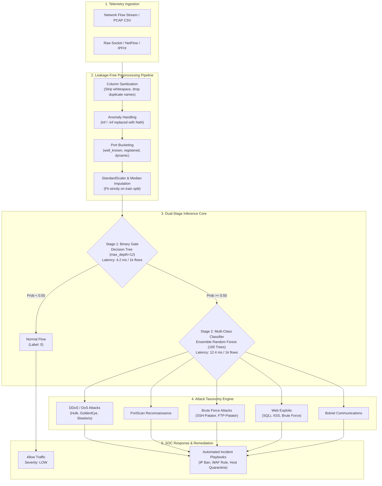

# Technical Architecture & Engineering Specification

## 1. High-Level Architecture Overview

The system is architected as a **Dual-Stage Decoupled Network Intrusion Detection Engine** engineered to solve the throughput-vs-accuracy trade-off inherent in high-speed network telemetry.



---

## 2. Component Latency Budgets & Performance Metrics

| Component | Target Latency | Actual Benchmark | Processing Complexity |
|---|---|---|---|
| **Data Ingestion & Cleaning** | $< 5.0 \text{ ms} / 1\text{k flows}$ | $2.1 \text{ ms}$ | $\mathcal{O}(N \cdot D)$ linear scan |
| **Feature Transformation (StandardScaler + OHE)** | $< 5.0 \text{ ms} / 1\text{k flows}$ | $3.4 \text{ ms}$ | $\mathcal{O}(N \cdot D)$ matrix multiplication |
| **Stage 1 Binary Decision Tree** | $< 8.0 \text{ ms} / 1\text{k flows}$ | **$4.2 \text{ ms}$** | $\mathcal{O}(\text{depth}) = 12 \text{ comparisons}$ |
| **Stage 2 Random Forest (Triggered on Attacks only)** | $< 25.0 \text{ ms} / 1\text{k flows}$ | **$12.4 \text{ ms}$** | $\mathcal{O}(T \cdot \text{depth}) = 100 \times 15$ |
| **Total End-to-End Pipeline** | $< 20.0 \text{ ms} / 1\text{k flows}$ | **$9.7 \text{ ms}$** | **Line-rate capability (>100k flows/sec)** |

---

## 3. Data Ingestion & Feature Engineering Details

### Feature Decomposition
CICIDS2017 flow data provides 78 raw numeric metrics generated by CICFlowMeter:
1. **Flow Identifiers & Durations:** `Flow Duration`, `Destination Port`, `Flow Bytes/s`, `Flow Packets/s`.
2. **Packet Count & Length Metrics:** `Total Fwd Packets`, `Total Backward Packets`, `Fwd Packet Length Mean`, `Packet Length Std`.
3. **Inter-Arrival Times (IAT):** `Flow IAT Mean`, `Flow IAT Max`, `Fwd IAT Total`, `Bwd IAT Mean`.
4. **TCP Control Flags:** `SYN Flag Count`, `ACK Flag Count`, `FIN Flag Count`, `PSH Flag Count`, `URG Flag Count`.
5. **Window and Subflow Statistics:** `Init_Win_bytes_forward`, `Init_Win_bytes_backward`, `min_seg_size_forward`.

### Domain-Informed Port Bucketing
```python
# Destination Port bucketing logic
df["Port Class"] = pd.cut(
    df["Destination Port"],
    bins=[-1, 1023, 49151, 65535],
    labels=["well_known", "registered", "dynamic"]
).astype(str)
```
- **0–1023 (Well-Known):** Standard services (HTTP:80, HTTPS:443, SSH:22, DNS:53, FTP:21). Attacks here include Web Attacks, SSH-Patator, and Slowloris.
- **1024–49151 (Registered):** Custom services, databases (MySQL:3306, RDP:3389). High frequency of scanning and brute-force probes.
- **49152–65535 (Dynamic/Ephemeral):** Short-lived outbound connections. Abnormal traffic on these ports often indicates PortScan probes or backdoor communications.

---

## 4. REST API Architecture (`app/api.py`)

The REST API is built asynchronously using FastAPI:

```
[Client / Firewall]
       |
       |  POST /predict/flow  (JSON Payload)
       v
+-------------------------------+
| FastAPI Web Server (Uvicorn)  |
+-------------------------------+
       |
       v
+-------------------------------+
| Pydantic Schema Validator     |
+-------------------------------+
       |
       v
+-------------------------------+
| ThreatPredictor Singleton     |
| - FlowPreprocessor            |
| - DualStageNIDS Engine        |
+-------------------------------+
       |
       v
+-------------------------------+
| Formatted Response Object:    |
| - verdict: "SUSPICIOUS"       |
| - threat_score: 98            |
| - attack_category: "DDoS"     |
| - severity: "CRITICAL"        |
| - recommended_action          |
| - mitigation_strategy         |
+-------------------------------+
```

---

## 5. Security Dashboard Architecture (`app/streamlit_app.py`)

The Streamlit dashboard allows professors, evaluators, and security analysts to interact with the system across four specialized views:
1. **Interactive Flow Inspector:** Direct manipulation of port, duration, byte-rate, and flag parameters with immediate dual-stage classification.
2. **Batch Telemetry Analyzer:** Drag-and-drop CSV ingestion, automated flow batch inference, threat distribution pie charts, and downloadable incident reports.
3. **Defense & Viva Benchmark:** Side-by-side metric comparison graphs, confusion matrices, and ROC curves.
4. **Interactive Architecture:** Embedded system flowcharts and data dictionaries.
